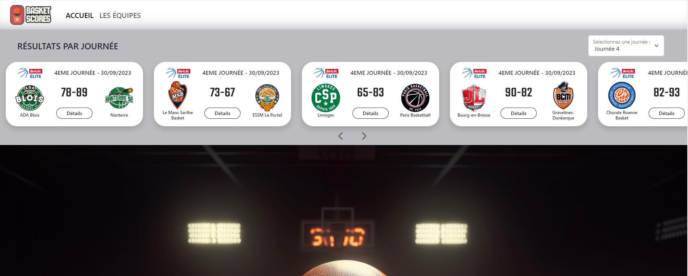
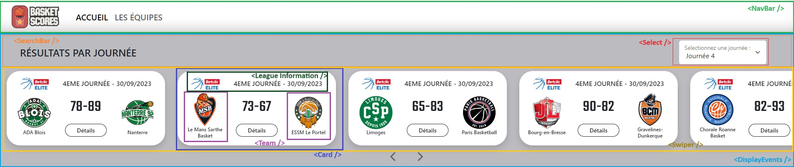
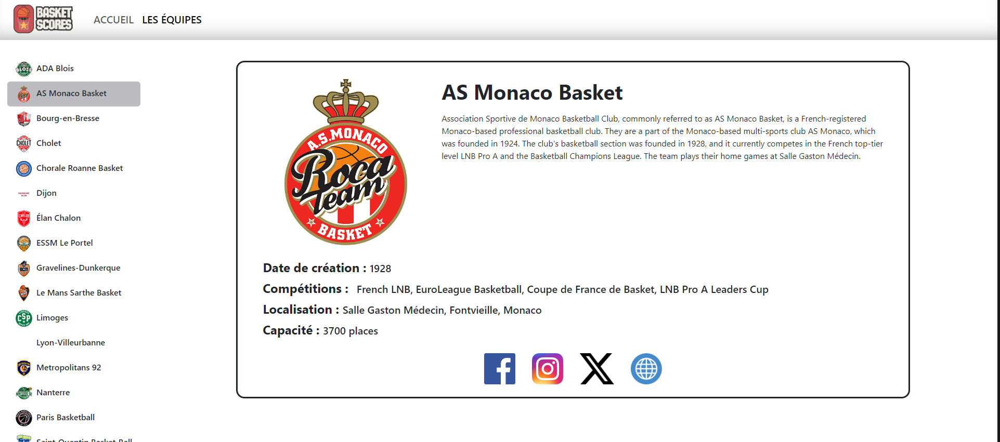

# Basket Scores

Application React qui affiche les résultats et les équipes de la Betclic Élite (LNB, première division française de basket), à partir de l'API publique [TheSportsDB](https://www.thesportsdb.com/).

C'est le projet qui m'a servi à **apprendre React** en 2024, après ma formation : un support d'exercice concret plutôt qu'un produit fini. J'utilise aujourd'hui React en entreprise.

## Stack technique

<p align="left">
  
</p>

- **React 18** et **Vite**
- **React Router 6** : routes imbriquées, `loader` pour charger les données, page d'erreur
- **Bootstrap 5** et **Swiper** (carrousel)
- **API REST** : TheSportsDB, version gratuite

## Ce que j'ai appris avec ce projet

- Découper une interface en composants réutilisables et leur passer des données (props)
- Gérer l'état et les effets avec `useState`, `useEffect` et `useRef`
- Appeler une API REST de façon asynchrone et gérer l'état de chargement
- Structurer la navigation avec React Router : routes imbriquées (`Outlet`), routes dynamiques (`/teams/:teamId`), chargement des données par `loader` et `useLoaderData`, gestion des erreurs avec `errorElement`

## Aperçu

### Résultats par journée

Un carrousel affiche les matchs de la journée choisie dans une liste déroulante. Le bouton *Détails* d'une carte affiche le détail du match sous le carrousel.




Découpage de la page d'accueil en composants :



### Équipes

Une barre latérale liste les clubs. Un clic charge la fiche du club, avec une URL propre à chaque équipe.



## Limites et pistes d'amélioration

Je voulais aller plus loin : statistiques et graphiques par équipe, classement, fiches joueurs. Je n'ai pas trouvé d'API gratuite assez complète pour le basket français. TheSportsDB ne donne les résultats que journée par journée, sans classement ni statistiques détaillées.

Avec le recul, je ferais évoluer le projet ainsi :
- passer par une API plus complète (payante), ou construire mes propres données
- mettre en cache les réponses de l'API pour limiter les requêtes
- héberger les logos des clubs : l'API ne fournit que des versions blanches, peu lisibles sur fond clair
- réorganiser l'arborescence des fichiers et retirer les composants inutiles

## Lancer le projet en local

Prérequis : Node.js 18+.

```bash
git clone https://github.com/JeanNoLimit/Basket_scores.git
cd Basket_scores
npm install
npm run dev
```

## Ressources

- Documentation [React](https://react.dev/) et [React Router](https://reactrouter.com/)
- OpenClassrooms : [Débutez avec React](https://openclassrooms.com/fr/courses/7008001-debutez-avec-react), [Créez une application React complète](https://openclassrooms.com/fr/courses/7150606-creez-une-application-react-complete)
- Tutoriels [Grafikart](https://grafikart.fr/tutoriels/introduction-react-1312)
